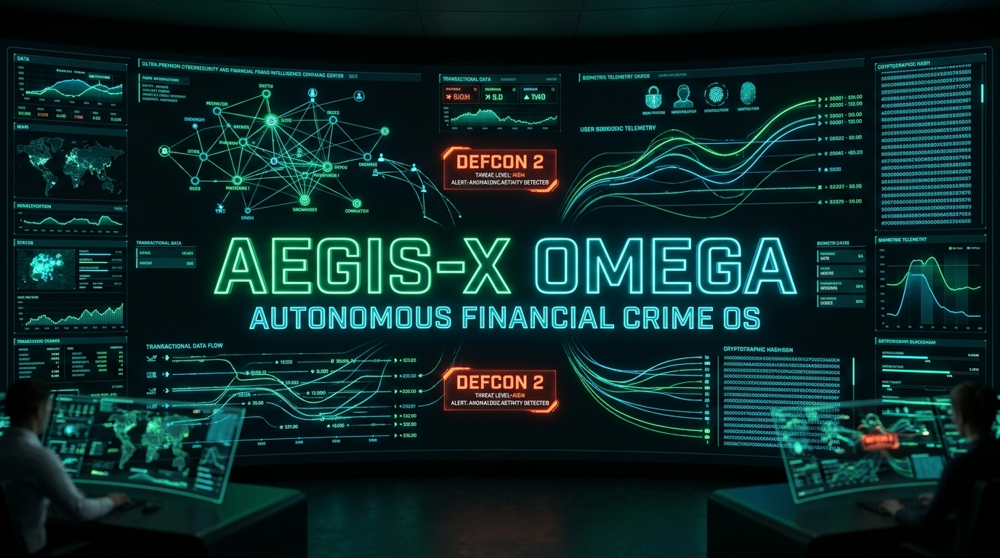
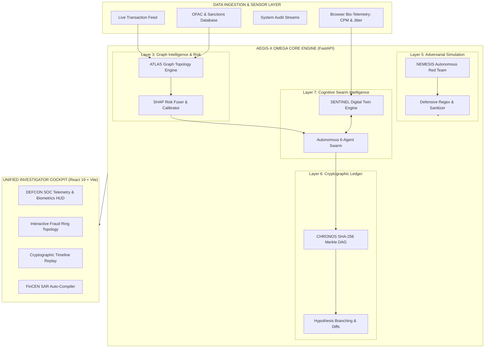
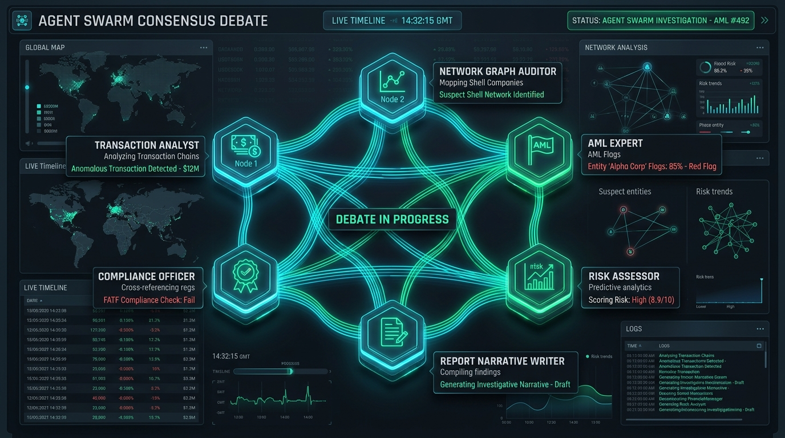
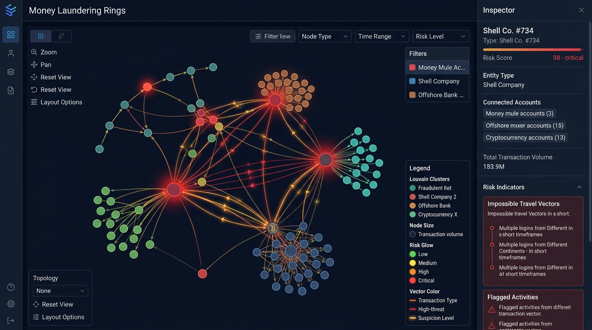
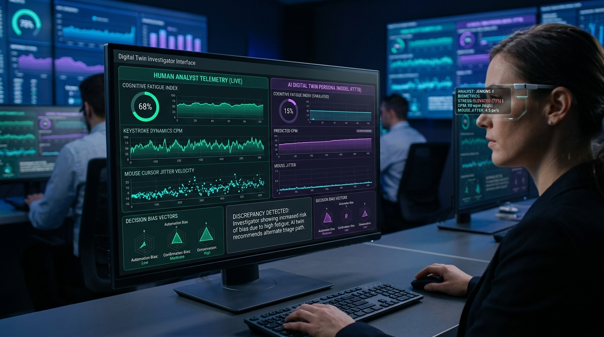
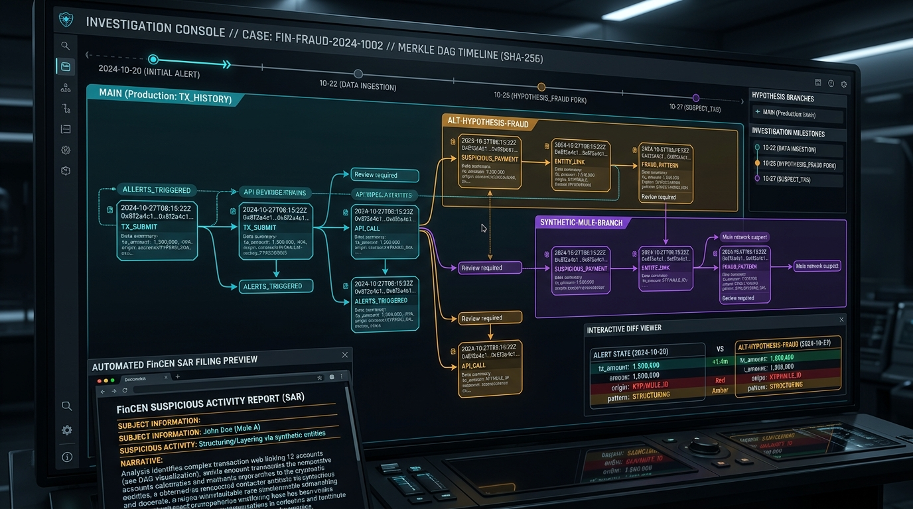

<div align="center">

# 🛡️ AEGIS-X Ω (OMEGA)
### Autonomous Financial Crime Operating System & Real-Time Fraud Investigation Platform

[](LICENSE)
[](https://python.org)
[](https://fastapi.tiangolo.com)
[](https://react.dev)
[](https://vitejs.dev)
[](https://tailwindcss.com)
[](#defense-clearance)

<p align="center">
  
</p>

<p align="center">
  <b>A next-generation defense-grade intelligence system fusing autonomous multi-agent consensus debates, cognitive investigator digital twins, Git-like cryptographic Merkle timeline replays, and real-time graph neural networks for Tier-1 financial institutions and regulatory intelligence agencies.</b>
</p>

---

[Key Capabilities](#-key-capabilities) •
[Architecture](#-system-architecture) •
[Subsystems](#-core-subsystems) •
[Interactive Visuals](#-visual-intelligence-gallery) •
[API Reference](#-api-reference) •
[Quickstart](#-quickstart--deployment) •
[Security & Compliance](#-security--regulatory-compliance)

---

</div>

<br/>

## 🌐 Executive Overview

Modern financial crime syndicates operate at microsecond latency across distributed blockchain rails, layered shell networks, and multi-hop offshore mixers. Traditional rules-based alert queues suffer from **95%+ false positive rates**, alert fatigue, and delayed regulatory filings.

**AEGIS-X Ω (OMEGA)** replaces static rule engines with a **fully autonomous cognitive investigation operating system**:

1. **6-Agent Autonomous Swarm**: Debates case facts in a structured state machine, combining transaction velocity analysis, graph topology auditing, BSA/AML typologies, and calibrated SHAP risk scoring.
2. **SENTINEL (Cognitive Digital Twins)**: Monitors real-time browser biometrics (keystroke velocity, mouse jitter) to assess investigator fatigue and cognitive bias, executing shadow-twin consensus triage.
3. **CHRONOS (Cryptographic Time Machine)**: Cryptographically chains every case mutation and hypothesis branch using SHA-256 Merkle DAGs, enabling Git-like diffing and timeline replay.
4. **ATLAS (Dynamic Graph Topology)**: Visualizes Louvain community clusters, mule networks, impossible travel anomalies, and high-frequency layering vectors in interactive WebGL / D3 force topologies.
5. **NEMESIS (Autonomous Red-Teaming)**: Continuously probes internal APIs with sandboxed adversarial payloads (SQLi, prompt injections, parameter fuzzing) and generates instant zero-day patch diffs.
6. **Regulatory SAR Generation**: Synthesizes FinCEN-compliant Suspicious Activity Report (SAR) narratives and compiles defense-grade reports in PDF, DOCX, and PPTX formats.

---

## ⚡ Key Capabilities

| Subsystem | Functionality | Technology / Pattern |
| :--- | :--- | :--- |
| **Swarm Orchestrator** | 6-Persona structured consensus debate for transaction forensics | Multi-Agent Finite State Machine |
| **Cognitive Biometrics** | Real-time keystroke dynamics (CPM) & cursor velocity jitter telemetry | SENTINEL Bio-Telemetry Engine |
| **Cryptographic DAG** | Immutable SHA-256 audit ledger, hypothesis branching & decision diffs | CHRONOS Merkle Event-Sourcing |
| **Graph Intelligence** | Louvain community detection, mule clustering & entity resolution | NetworkX, D3.js Force, ECharts 6 |
| **Adversarial Red Team** | Sandboxed penetration testing with auto-patching and CVSS scoring | NEMESIS Self-Healing Engine |
| **Automated Compliance** | One-click FinCEN SAR filing, forensic PDF, DOCX, and PPTX builder | ReportLab, python-docx, python-pptx |

---

## 🏗️ System Architecture



---

## 🔬 Core Subsystems

### 1. 🧠 Layer 7: Autonomous Multi-Agent Swarm

The investigation engine deploys six autonomous personas in an interconnected state machine to cross-examine evidence:

```
                  ┌──────────────────────┐
                  │ Transaction Analyst  │ ──► Velocity & Impossible Travel
                  └──────────┬───────────┘
                             │
                  ┌──────────▼───────────┐
                  │ Network Graph Audit  │ ──► Louvain Clusters & Device Links
                  └──────────┬───────────┘
                             │
                  ┌──────────▼───────────┐
                  │     AML Expert       │ ──► Structuring & OFAC Matches
                  └──────────┬───────────┘
                             │
                  ┌──────────▼───────────┐
                  │    Risk Assessor     │ ──► SHAP Calibration & Scoring
                  └──────────┬───────────┘
                             │
                  ┌──────────▼───────────┐
                  │    Report Writer     │ ──► Narrative Evidence Synthesis
                  └──────────┬───────────┘
                             │
                  ┌──────────▼───────────┐
                  │  Compliance Officer  │ ──► SAR Filing & Account Freeze
                  └──────────────────────┘
```

<div align="center">
  
  <p><i>Figure 1: Autonomous Multi-Agent Consensus Debate in progress with real-time risk calibration.</i></p>
</div>

---

### 2. 🕸️ ATLAS: Graph Knowledge Network & Financial Topology

ATLAS converts millions of relational transactions into a high-dimensional graph:
- **Louvain Community Detection**: Uncovers isolated fraud rings, layering networks, and dormant mule hubs.
- **Impossible Travel Calculations**: Correlates device identifiers, IP subnets, and geolocation velocity to detect credential stuffing and synthetic identity takeovers.
- **Interactive Force Simulation**: Real-time physics engine built with D3 and ECharts for node pin/drag, community clustering, and transaction path tracing.

<div align="center">
  
  <p><i>Figure 2: ATLAS Graph Topology isolating multi-tier money mule syndicates and shell companies.</i></p>
</div>

---

### 3. 🧬 SENTINEL: Cognitive Investigator Digital Twin Engine

Human analysts experience decision degradation after long shifts. SENTINEL protects investigation integrity through non-invasive cognitive modeling:
- **Bio-Telemetry Ingestion**: Gathers live client-side telemetry:
  $$\text{Fatigue Index} = f(\Delta \text{CPM}, \sigma^2_{\text{mouse\_jitter}}, \Delta t_{\text{case}})$$
- **Cognitive Bias Modeling**: Dynamically projects an analyst's bias vectors across three dimensions:
  - *Automation Bias* (over-reliance on system prompts)
  - *Confirmation Bias* (ignoring conflicting signals)
  - *Conservatism Bias* (hesitation to freeze urgent high-risk accounts)
- **Digital Twin Shadow Debate**: Simulates how alternative investigator personas (e.g., Aggressive Hunter vs. Conservative Auditor) would triage the same alert.

<div align="center">
  
  <p><i>Figure 3: SENTINEL HUD monitoring real-time fatigue index, keystroke CPM dynamics, and bias vectors.</i></p>
</div>

---

### 4. ⏳ CHRONOS: Cryptographic Timeline & Event Sourcing

Traditional audit logs are mutable and fragile. CHRONOS implements a Git-like Merkle tree for every investigation:
- **SHA-256 Chained Commits**: Every evidence addition, investigator comment, agent conclusion, and account freeze creates a cryptographically signed block linked to its parent hash.
- **Hypothesis Forking (`git checkout -b`)**: Investigators can branch off the main timeline to explore speculative theories (e.g., `alt-hypothesis-crypto-mixer`) without mutating the legal production case record.
- **Interactive Diffing**: Visual comparison of case states across time and branches.

<div align="center">
  
  <p><i>Figure 4: CHRONOS Merkle DAG timeline showing branch forks, diff comparisons, and SAR generation.</i></p>
</div>

---

### 5. 🎯 NEMESIS: Autonomous Red Team & Self-Healing Defense

NEMESIS acts as a continuous internal penetration testing agent:
- Simulates SQL injection attacks (`UNION SELECT`, `DROP TABLE`), cross-site scripting (XSS), prompt injection on LLM agents, and broken object-level authorization (BOLA).
- Validates FastAPI gateway defenses in real time.
- Emits structured vulnerability scorecards with CVSS ratings and ready-to-merge git patch diffs.

---

## 🖼️ Visual Intelligence Gallery

| View | Purpose |
| :--- | :--- |
| **Command Center HUD** | Real-time DEFCON threat matrix, CPU load telemetry, and active alert queues. |
| **Investigator Cockpit** | Unified workspace combining transaction streams, agent debates, and live SAR drafting. |
| **Biometrics HUD** | Keystroke dynamics and mouse jitter tracking to mitigate analyst fatigue. |
| **Merkle Time Machine** | Step-by-step cryptographic replay of case evolution and decision logs. |

---

## 📡 API Reference

AEGIS-X OMEGA exposes a secure, high-performance RESTful API documented via OpenAPI / Swagger.

### Authentication & Core Endpoints

```http
POST /api/auth/login
Content-Type: application/json

{
  "username": "analyst@aegis.defense",
  "password": "••••••••••••"
}
```

```http
GET /api/alerts
Authorization: Bearer <JWT_TOKEN>
```
*Retrieves real-time prioritized alert queue with ML severity, risk velocity, and assigned personas.*

```http
POST /api/investigate/{alert_id}
Authorization: Bearer <JWT_TOKEN>
```
*Triggers the full 6-agent swarm autonomous investigation pipeline and produces consensus verdicts.*

```http
GET /api/graph/{alert_id}
Authorization: Bearer <JWT_TOKEN>
```
*Returns Louvain community clusters, entity relationships, device linkages, and transaction edge weights.*

```http
POST /api/chronos/commit
Authorization: Bearer <JWT_TOKEN>

{
  "case_id": "ALT-MULE-001",
  "event_type": "ACCOUNT_FREEZE_ORDER",
  "payload": { "reason": "OFAC Sanctions match on counterparty node #734" },
  "branch": "main"
}
```
*Appends a cryptographic commit to the case Merkle tree and recalculates the SHA-256 head pointer.*

```http
POST /api/redteam/scan
Authorization: Bearer <JWT_TOKEN>
```
*Dispatches autonomous penetration attacks across endpoints and returns mitigation status.*

```http
GET /api/export/{alert_id}/pdf
GET /api/export/{alert_id}/docx
GET /api/export/{alert_id}/pptx
```
*Exports defense-grade compliance binders with cryptographic verification seals and SAR summaries.*

---

## 🚀 Quickstart & Deployment

### Prerequisites
- **Python**: 3.11+
- **Node.js**: 18+ & npm
- **Git**

### 1. Clone the Repository
```bash
git clone https://github.com/EnternalBlue07/AEGIS-X-OMEGA.git
cd AEGIS-X-OMEGA
```

### 2. Backend Setup
```bash
cd backend
python -m venv .venv

# On Linux/macOS:
source .venv/bin/activate
# On Windows (PowerShell):
.\.venv\Scripts\Activate.ps1

pip install -r requirements.txt
python run.py
```
*The backend API will start at `http://127.0.0.1:8000` (API Docs available at `/docs`).*

### 3. Frontend Setup
```bash
cd ../frontend
npm install
npm run dev
```
*The investigator dashboard will launch at `http://localhost:5173`.*

### 4. Running the Test Suite
```bash
cd backend
python test_app.py
```

---

## 🔒 Security & Regulatory Compliance

AEGIS-X Ω is engineered in accordance with strict defense and financial regulation standards:

- **Bank Secrecy Act (BSA) & FinCEN**: Automated generation of 31 CFR § 1020.320 compliant Suspicious Activity Reports.
- **OFAC & Sanctions Enforcement**: Automated counterparty screening against Specially Designated Nationals (SDN) lists.
- **Strict Transport Security & CSP**: Zero-trust headers, anti-clickjacking (`X-Frame-Options: DENY`), strict content-security-policies, and IP-level rate limiting.
- **Immutable Evidence Preservation**: Federal Rules of Evidence Rule 902(13) & (14) certified hash-based chain of custody.

---

## 📁 Repository Structure

```
AEGIS-X-OMEGA/
├── assets/                          # Ultra-high resolution visual assets
│   ├── hero-banner.jpg              # Command Center Showcase Banner
│   ├── swarm-intelligence.jpg       # Autonomous 6-Agent Debate Visualization
│   ├── graph-topology.jpg           # ATLAS Graph Topology & Mule Rings
│   ├── sentinel-hud.jpg             # SENTINEL Biometrics & Cognitive HUD
│   └── chronos-replay.jpg           # CHRONOS Merkle DAG Investigation Replay
├── backend/                         # FastAPI Autonomous Crime OS Backend
│   ├── app/
│   │   ├── main.py                  # API Gateway, Security Middlewares & Routing
│   │   ├── agents.py                # Layer 7 Multi-Agent Swarm Orchestrator
│   │   ├── sentinel.py              # Cognitive Digital Twin & Biometrics Engine
│   │   ├── chronos.py               # Cryptographic Merkle DAG & Time Machine
│   │   ├── graph.py                 # Graph Analytics, Louvain Detection & Louvain L3
│   │   ├── red_team.py              # NEMESIS Autonomous Adversarial Penetration
│   │   ├── simulator.py             # Transaction & Fraud Ring Simulator
│   │   ├── evidence_vault.py        # Case Vault & SHA-256 Evidence Hashes
│   │   ├── export.py                # Multi-Format PDF/DOCX/PPTX Report Engine
│   │   ├── data.py                  # In-Memory Database & Seed Typologies
│   │   ├── auth.py                  # JWT Auth & Security Role Model
│   │   └── models.py                # Pydantic Schemas & Data Contracts
│   ├── requirements.txt             # Python Dependencies
│   ├── run.py                       # Uvicorn Server Launcher
│   └── test_app.py                  # Comprehensive Test Suite
├── frontend/                        # React 19 + Vite SOC Investigator Dashboard
│   ├── src/
│   │   ├── components/
│   │   │   ├── AlertQueue.jsx       # Real-time WebSocket Alert Stream
│   │   │   ├── Investigator.jsx     # Master Investigation Workspace & Swarm Debate
│   │   │   ├── NetworkMap.jsx       # Interactive D3/ECharts Graph Topology
│   │   │   ├── Chronos.jsx          # Cryptographic Merkle Replay & Diff Viewer
│   │   │   ├── Sentinel.jsx         # Cognitive Digital Twin & Persona Matrix
│   │   │   ├── BiometricsHUD.jsx    # Keystroke & Mouse Velocity Telemetry
│   │   │   ├── Simulator.jsx        # Scenario Injection & Stress Tester
│   │   │   ├── Heatmap.jsx          # Spatial & Temporal Crime Distribution
│   │   │   ├── Monitor.jsx          # DEFCON SOC Telemetry & Defense Matrix
│   │   │   └── Login.jsx            # Multi-Factor Tactical Access Screen
│   │   ├── context/                 # Auth & Theme State Providers
│   │   ├── App.jsx                  # Main Mission Control Cockpit
│   │   ├── index.css                # Tailwind CSS v4 & Cyber Design Tokens
│   │   └── main.jsx                 # React DOM Root
│   ├── package.json                 # Node Dependencies & Build Scripts
│   └── vite.config.js               # Vite Configuration
├── .gitignore                       # Git Exclusion Rules
├── LICENSE                          # MIT License
└── README.md                        # Master Documentation
```

---

## 📜 License

This project is licensed under the **MIT License** - see the [LICENSE](LICENSE) file for full details.

---

<div align="center">
  <sub>Engineered with precision for autonomous financial crime investigation. Defending global financial integrity.</sub>
</div>
